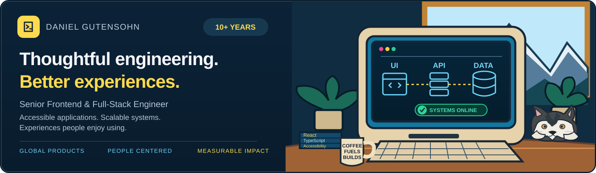
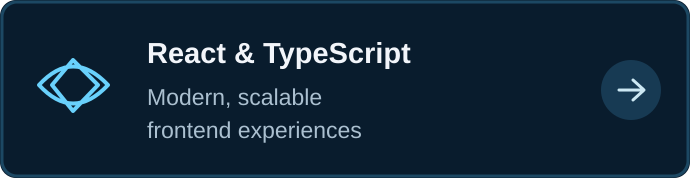
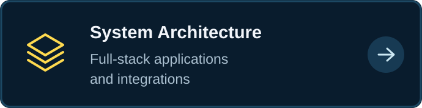
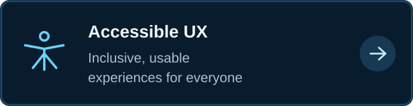
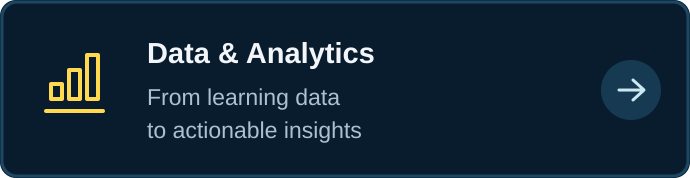
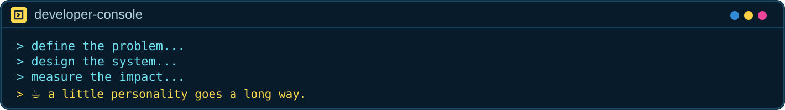

<div align="center">

<picture>
  <source media="(max-width: 600px)" srcset="assets/illustrated-hero-mobile.svg" />
  
</picture>

**Senior Frontend & Full-Stack Engineer** · 10+ years building accessible applications and connected systems

[**Portfolio ↗**](https://dgutensohn03.github.io/dg-portfolio/) · [**LinkedIn ↗**](https://www.linkedin.com/in/daniel-gutensohn/) · [**Repositories ↗**](https://github.com/dgutensohn03?tab=repositories)

</div>

<a href="#frontend--full-stack"></a>

<a href="#architecture--integration"></a>

<a href="#accessible-ux"></a>

<a href="#data--analytics"></a>



## About me

I've spent **10+ years** turning complex requirements into applications that feel straightforward to use. I work across frontend engineering, full-stack architecture, interface design, and data integrations—from defining a problem to delivering and improving a product.

My experience includes enterprise applications serving audiences in **50+ countries**, learning platforms, analytics dashboards, and accessible interfaces. I care about implementation quality *and* whether the result solves the right problem.

### Frontend & full-stack
React · TypeScript · Next.js · Node.js · REST APIs · Authentication · Testing · CI/CD

### Architecture & integration
Application design · PostgreSQL · Firebase · Google Cloud Functions · Data flows · Reusable components

### Accessible UX
Semantic HTML · Keyboard and screen-reader support · WCAG 2.1 AA practices · Design systems

### Data & analytics
xAPI · SCORM · LMS/LRS integrations · Plotly · Event modeling · Reporting

### How I work

**Discover → Architect → Build → Validate → Improve**

I make constraints and tradeoffs explicit, choose maintainable approaches, collaborate across disciplines, and measure whether what we shipped actually helped. Senior engineering is about judgment and team outcomes—not just knowing a framework.

## D'oh! → Aha! · Engineering decisions

A little personality, backed by a lot of engineering judgment. Here's how I approach common assumptions, tradeoffs, and unexpected problems.

<sub>Expand a scenario to see the reasoning. These are representative engineering situations, not disclosures of confidential client issues.</sub>

<details>
<summary><strong>01 / Performance — Measure before optimizing</strong></summary>

**The situation:** A team wants to add caching immediately because a reporting dashboard has become sluggish.

**My approach:** First establish where time is spent: user interaction, rendering, request waterfalls, backend processing, or database queries. I would profile the critical path, validate the bottleneck, then choose an intervention based on evidence—not fashion. I'd measure before and after, and document the tradeoffs around complexity, consistency, and maintainability.

**What this draws on:** React/TypeScript, backend integrations, PostgreSQL, and analytics applications.

</details>

<details>
<summary><strong>02 / Accessibility — Test the whole user journey</strong></summary>

**The situation:** A workflow looks finished but doesn't work reliably with keyboard navigation or assistive technology.

**My approach:** Test the end-to-end task, inspect semantics and focus order, prioritize blockers, correct the underlying interaction pattern, and add regression coverage. Accessibility is an engineering quality requirement, not an overlay or last-minute checklist.

**What this draws on:** Design systems, component architecture, semantic HTML, focus management, ARIA, and WCAG 2.1 AA practices.

</details>

<details>
<summary><strong>03 / Analytics — Find the question behind the chart</strong></summary>

**The situation:** Stakeholders see course completions but can't identify where learners are struggling.

**My approach:** Start with the decisions stakeholders need to make. Define meaningful metrics, structure the xAPI event model, verify data quality, and design focused dashboards that reveal progress, attempts, and outcomes rather than visual noise.

**What this draws on:** LMS/LRS integration, xAPI, PostgreSQL, React, and Plotly.

</details>

<details>
<summary><strong>🍩 Bonus / Developer-console Easter egg</strong></summary>

```text
$ diagnose --production
✓ Root cause identified
✓ Accessible experience verified
✓ Technical debt documented
✓ Changes delivered with tests

// D'oh! was a hypothesis. Aha! was the evidence.
```

The best part of the job is making complicated things feel effortless for the people using them.

</details>

## Professional experience

**Lead Full-Stack / Frontend Engineer · LHT Learning**  
*2019–2025*

Led development across learning platforms and enterprise web applications, connecting requirements, application architecture, frontend engineering, data integrations, analytics, and accessibility. Collaborated across design, learning, and technical teams to deliver experiences for varied users and industries.

**Frontend Development & UI Design · Xcelerate Media**  
*2014–2019*

Built interactive applications and learning experiences with a focus on interface design, animation, reusable patterns, and intuitive interaction.

**Domains:** Healthcare · Enterprise learning · Consumer products · Utilities

## Selected evidence

A few public examples of my engineering work—not the full extent of my professional experience:

- **[High Colorado](https://github.com/dgutensohn03/High-Colorado)** — map-first UX, weather integrations, offline-capable PWA, and product decision support.
- **[Engineering portfolio](https://github.com/dgutensohn03/dg-portfolio)** — Next.js, TypeScript, accessible interface patterns, and technical storytelling.
- **[VCERT](https://github.com/dgutensohn03/VCert)** — personalized learning workflows and progress tracking.
- **[xAPI-ify](https://github.com/dgutensohn03/xAPI-ify)** — learning-event interoperability.

<details>
<summary><strong>Technology reference</strong></summary>

**Frontend:** React · TypeScript · JavaScript · Next.js · HTML · CSS · Tailwind  
**Backend & data:** Node.js · REST APIs · PostgreSQL · Firebase · Google Cloud Functions  
**Quality & delivery:** GitHub Actions · Docker · Jest · Playwright · Accessibility testing  
**Learning & analytics:** xAPI · SCORM · LMS/LRS · Learning Locker · Plotly  
**Design:** Figma · Component systems · Responsive UI · WCAG

</details>

---

<div align="center">

**Building something complex? Let's make it clear, useful, and maintainable.**

[**Explore my portfolio**](https://dgutensohn03.github.io/dg-portfolio/) · [**Connect on LinkedIn**](https://www.linkedin.com/in/daniel-gutensohn/)

</div>
