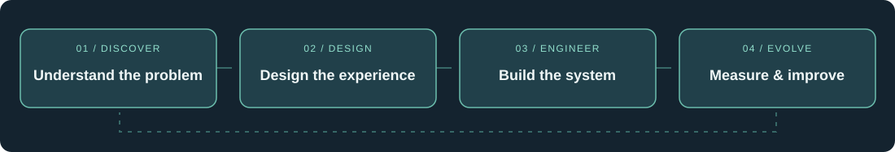

### Senior Frontend & Full-Stack Engineer · UX Engineering · Learning Technology

**I make complex systems feel simple — from the architecture underneath to the experience on screen.**

[Portfolio](https://dgutensohn03.github.io/dg-portfolio/) · [LinkedIn](https://www.linkedin.com/in/daniel-gutensohn/) · [Explore my work](https://github.com/dgutensohn03?tab=repositories)

---

## The short version

I've spent **10+ years** building web experiences and the systems behind them: architecting frontend applications, connecting services and data, designing reusable interfaces, and making complicated workflows easier to understand.

My work spans **enterprise software, learning technology, and analytics**, including products for international audiences across **50+ countries**. I bring together software engineering, user experience, and clear technical communication — and I care as much about *why* a solution works as *how* it was built.

> **My approach:** Understand the problem. Make the tradeoffs explicit. Build something maintainable. Validate the experience. Keep improving it.

## What I bring to a team

| Engineering systems | Designing experiences | Turning data into decisions |
| :--- | :--- | :--- |
| React, TypeScript, Next.js, Node.js, REST APIs, PostgreSQL, authentication, CI/CD | Component architecture, design systems, accessibility, responsive interfaces, UI testing | xAPI, LMS/LRS integrations, data modeling, analytics dashboards, Plotly, learning measurement |
| **I connect architecture to delivery.** | **I design for real people.** | **I make complicated information useful.** |

### From problem to outcome

## Engineering Decisions · Explore how I think

**Three realistic situations. No trick questions.** Choose a scenario, consider your approach, then expand the reasoning. These are representative situations informed by my professional experience, not descriptions of specific confidential incidents.

<strong>01 · An application is slow. Where do you start?</strong> &nbsp; <code>Performance · Full-stack</code>

**Scenario:** A reporting dashboard is taking noticeably longer to load as usage grows. The team wants to add caching immediately.

**Think it through:** Is the bottleneck browser rendering, the API, network transfer, or database queries? What evidence would you gather before changing architecture?

Reveal my approach

I start with measurements, not a rewrite: trace the critical user journey, separate network latency from rendering cost, examine request waterfalls and payloads, and inspect backend timings and query behavior. Then I target the highest-impact constraint, compare before/after results, and document tradeoffs like cache freshness and complexity.

**Experience behind it:** React/TypeScript interfaces; Node.js and cloud functions; PostgreSQL-backed analytics; data-heavy dashboards.

<strong>02 · A workflow works with a mouse but excludes other users.</strong> &nbsp; <code>Accessibility · UX engineering</code>

**Scenario:** A complex web workflow passes visual review, but keyboard and assistive-technology users are struggling.

**Think it through:** Which steps do you test? How do you prioritize what to fix? How do you prevent regressions?

Reveal my approach

I reproduce the complete task with a keyboard and screen reader, inspect semantic structure and focus order, check error messaging and contrast, and prioritize barriers that prevent task completion. I fix the underlying component behavior rather than relying on an overlay, then add practical regression checks and guidance for the team.

**Experience behind it:** Accessible component patterns; semantic HTML, ARIA and focus management; WCAG 2.1 AA practices; UI quality assurance.

<strong>03 · A learning dashboard has data but no meaningful answers.</strong> &nbsp; <code>Analytics · Learning systems</code>

**Scenario:** Stakeholders can see course completions but can't tell where learners struggle or whether training is effective.

**Think it through:** What should the system measure? How should events be modeled? Which visualizations actually help someone act?

Reveal my approach

I begin with the decisions stakeholders need to make. Then I define meaningful learning events and metrics, validate the xAPI data model and reporting pipeline, and design focused views around progress, attempts, completion, and outcomes. The goal isn't more charts — it's trustworthy evidence people can use.

**Experience behind it:** LMS/LRS integrations; xAPI and SCORM; React and Plotly dashboards; PostgreSQL and analytics workflows.

Built for GitHub: the challenges use accessible, expandable Markdown rather than JavaScript that GitHub READMEs can't execute.

## Experience, not just a stack

**2019–2025 · LHT Learning**  
Led frontend and learning-technology development across enterprise applications and learning platforms. Worked across requirements, architecture, interface engineering, integration, analytics, accessibility, and delivery in collaboration with multidisciplinary teams.

**2014–2019 · Xcelerate Media**  
Built interactive web and digital learning experiences, combining frontend implementation with interface design, animation, and user-centered problem solving.

Across these roles, I've supported teams working in **healthcare, consumer products, utilities, and other enterprise environments**. My strength is moving between product, design, engineering, and learning requirements without losing sight of the end user.

## A few examples of the work

- **[High Colorado](https://github.com/dgutensohn03/High-Colorado)** — map-first planning, responsive interaction, external data, and offline-capable PWA architecture.
- **[Engineering portfolio](https://github.com/dgutensohn03/dg-portfolio)** — the design and engineering approach behind this site, including reusable UI and accessible presentation.
- **[VCERT](https://github.com/dgutensohn03/VCert)** — a learning-platform example connecting personalized experiences and progress tracking.
- **[xAPI-ify](https://github.com/dgutensohn03/xAPI-ify)** — exploration of learning-event interoperability and the xAPI ecosystem.

## In practice

`React` · `TypeScript` · `Next.js` · `JavaScript` · `Node.js` · `REST APIs` · `PostgreSQL` · `Firebase` · `GCP` · `Docker` · `GitHub Actions` · `Playwright` · `Figma` · `WCAG` · `xAPI` · `SCORM`

---

**Have a complicated problem worth simplifying?**

[See my portfolio](https://dgutensohn03.github.io/dg-portfolio/) · [Connect on LinkedIn](https://www.linkedin.com/in/daniel-gutensohn/)

Clear thinking. Thoughtful engineering. Useful experiences.

