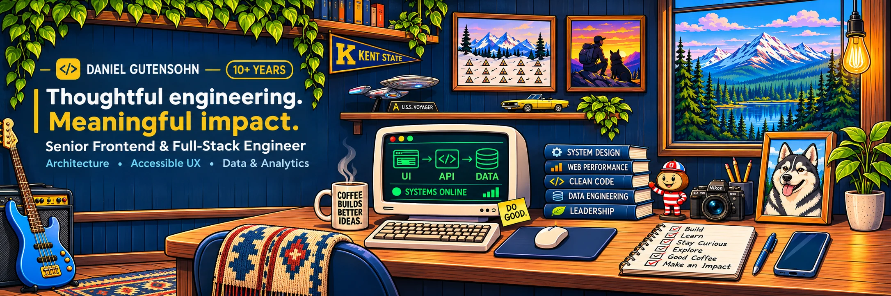

<div align="center">

<picture>
  <source media="(max-width: 600px)" srcset="assets/daniel-hero-mobile.webp" type="image/webp" />
  
</picture>

<p align="center">
  <a href="https://dgutensohn03.github.io/dg-portfolio/" aria-label="Visit engineering portfolio"></a>&nbsp;
  <a href="https://www.linkedin.com/in/daniel-gutensohn/" aria-label="View LinkedIn profile"></a>&nbsp;
  <a href="https://github.com/dgutensohn03?tab=repositories" aria-label="Explore GitHub repositories"></a>
</p>

</div>

<br />

## What I bring

I build **fast, accessible, responsive web applications** with React, Next.js, and TypeScript—balancing polished user experiences with maintainable frontend architecture.

My work spans reusable component systems, complex user workflows, API integrations, and products serving audiences in **50+ countries**. I bring a full-stack perspective to frontend decisions without losing sight of usability, performance, or delivery.

| Frontend strength | What I bring |
| :--- | :--- |
| **React, Next.js & TypeScript** | Component architecture, typed interfaces, routing, stateful workflows, integration with APIs, and maintainable application patterns. |
| **Performance & responsive UX** | Profiling, rendering and loading improvements, responsive layout decisions, and a measurement-first approach to Core Web Vitals. |
| **Accessibility & design systems** | Semantic HTML, keyboard and screen-reader workflows, focus management, reusable UI components, and WCAG 2.1 AA-aligned practices. |
| **Full-stack collaboration** | Node.js, authentication, PostgreSQL, cloud functions, CI/CD, analytics, and cross-functional design-to-delivery ownership. |

**Beyond frontend:** I also build learning platforms and data-rich applications using xAPI, SCORM, LMS/LRS integrations, and analytics dashboards. Those skills broaden my perspective; they don't define the only work I do.

## How I work

**01 / Understand** — Clarify the real problem, user needs, constraints, and success criteria.

**02 / Architect** — Choose practical boundaries between interface, application logic, services, and data; explain the tradeoffs.

**03 / Deliver** — Build accessible, maintainable experiences with reusable patterns, testing, and reliable integration.

**04 / Improve** — Measure behavior and quality, learn from evidence, and refine the system.

> A senior engineer's job isn't just to ship features. It's to reduce uncertainty, make good technical decisions, and help teams deliver useful software sustainably.

## D'oh! → Aha! · Engineering decisions

A little personality, backed by a lot of engineering judgment. Here's how I approach common assumptions, tradeoffs, and unexpected problems.

<sub>Expand a scenario to see the reasoning. These are representative engineering situations, not disclosures of confidential client issues.</sub>

<details>
<summary><strong>01 / Performance — Measure before optimizing</strong></summary>

**The situation:** A team wants to add caching immediately because a reporting dashboard has become sluggish.

**My approach:** First establish where time is spent: user interaction, rendering, request waterfalls, backend processing, or database queries. I would profile the critical path, validate the bottleneck, then choose an intervention based on evidence. I'd measure before and after, and document the tradeoffs around complexity, consistency, and maintainability.

**What this draws on:** React/TypeScript, backend integrations, PostgreSQL, and analytics applications.

</details>

<details>
<summary><strong>02 / Accessibility — Test the whole user journey</strong></summary>

**The situation:** A workflow looks finished but doesn't work reliably with keyboard navigation or assistive technology.

**My approach:** Test the end-to-end task, inspect semantics and focus order, prioritize blockers, correct the underlying interaction pattern, and add regression coverage. Accessibility is an engineering quality requirement, not an overlay or last-minute checklist.

**What this draws on:** Design systems, component architecture, semantic HTML, focus management, ARIA, and WCAG 2.1 AA practices.

</details>

<details>
<summary><strong>03 / Analytics — Find the question behind the chart</strong></summary>

**The situation:** Stakeholders see course completions but can't identify where learners are struggling.

**My approach:** Start with the decisions stakeholders need to make. Define meaningful metrics, structure the xAPI event model, verify data quality, and design focused dashboards that reveal progress, attempts, and outcomes rather than visual noise.

**What this draws on:** LMS/LRS integration, xAPI, PostgreSQL, React, and Plotly.

</details>

<details>
<summary><strong>🍩 Bonus / Developer-console Easter egg</strong></summary>

```text
$ diagnose --production
✓ Root cause identified
✓ Accessible experience verified
✓ Technical debt documented
✓ Changes delivered with tests

// D'oh! was a hypothesis. Aha! was the evidence.
```

The best part of the job is making complicated things feel effortless for the people using them.

</details>

## Experience

**Lead frontend / full-stack engineering · LHT Learning**  
*2019–2025*

Led development across learning platforms and enterprise web applications, connecting requirements, application architecture, frontend engineering, data integrations, analytics, and accessibility. Collaborated across design, learning, and technical teams to deliver experiences for varied users and industries.

**Frontend Development & UI Design · Xcelerate Media**  
*2014–2019*

Built interactive applications and learning experiences with a focus on interface design, animation, reusable patterns, and intuitive interaction.

**Domains:** Healthcare · Enterprise learning · Consumer products · Utilities

## Selected evidence

A few public examples of my engineering work—not the full extent of my professional experience:

- **[High Colorado](https://github.com/dgutensohn03/High-Colorado)** — map-first UX, weather integrations, offline-capable PWA, and product decision support.
- **[Engineering portfolio](https://github.com/dgutensohn03/dg-portfolio)** — Next.js, TypeScript, accessible interface patterns, and technical storytelling.
- **[VCERT](https://github.com/dgutensohn03/VCert)** — personalized learning workflows and progress tracking.
- **[xAPI-ify](https://github.com/dgutensohn03/xAPI-ify)** — learning-event interoperability.

<details>
<summary><strong>Technology reference</strong></summary>

**Frontend:** React · TypeScript · JavaScript · Next.js · HTML · CSS · Tailwind  
**Backend & data:** Node.js · REST APIs · PostgreSQL · Firebase · Google Cloud Functions  
**Quality & delivery:** GitHub Actions · Docker · Jest · Playwright · Accessibility testing  
**Learning & analytics:** xAPI · SCORM · LMS/LRS · Learning Locker · Plotly  
**Design:** Figma · Component systems · Responsive UI · WCAG

</details>

---

<div align="center">

**Building something complex? Let's make it clear, useful, and maintainable.**

[**Explore my portfolio**](https://dgutensohn03.github.io/dg-portfolio/) · [**Connect on LinkedIn**](https://www.linkedin.com/in/daniel-gutensohn/)

</div>
