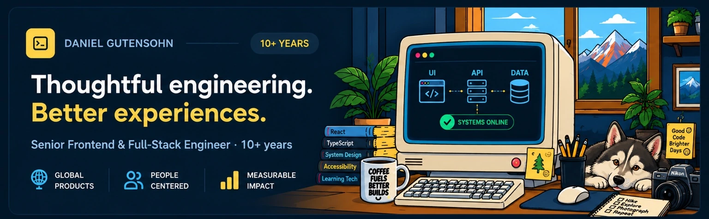

<div align="center">

<picture>
  <source media="(max-width: 600px)" srcset="assets/daniel-cooper-workstation-mobile.webp" type="image/webp" />
  
</picture>

**Senior Frontend & Full-Stack Engineer** · 10+ years building accessible applications and connected systems

[**Portfolio ↗**](https://dgutensohn03.github.io/dg-portfolio/) · [**LinkedIn ↗**](https://www.linkedin.com/in/daniel-gutensohn/) · [**Repositories ↗**](https://github.com/dgutensohn03?tab=repositories)

</div>

<a href="#frontend--full-stack"></a>

<a href="#architecture--integration"></a>

<a href="#accessible-ux"></a>

<a href="#data--analytics"></a>


##  About me

I build the **interfaces people use** and the **systems that make them work**. Over 10+ years, I've led development across enterprise applications, learning platforms, and data-rich products—connecting React and TypeScript frontends to authentication, APIs, and analytics.

My experience includes products supporting audiences in **50+ countries**. I care about the tradeoffs behind a solution: accessibility, reliability, maintainability, and whether the result actually helps someone.

<a id="frontend--full-stack"></a>

### Frontend & full-stack
React · TypeScript · Next.js · Node.js · REST APIs · Authentication · Testing · CI/CD

<a id="architecture--integration"></a>

### Architecture & integration
Application design · PostgreSQL · Firebase · Google Cloud Functions · Data flows · Reusable components

<a id="accessible-ux"></a>

### Accessible UX
Semantic HTML · Keyboard and screen-reader support · WCAG 2.1 AA practices · Design systems

<a id="data--analytics"></a>

### Data & analytics
xAPI · SCORM · LMS/LRS integrations · Plotly · Event modeling · Reporting

###  How I work

**Discover → Architect → Build → Validate → Improve**

I make constraints and tradeoffs explicit, choose maintainable approaches, collaborate across disciplines, and measure whether what we shipped actually helped. My focus is reducing uncertainty, making practical technical choices, and helping teams deliver software that holds up beyond launch.

##  Engineering decisions · D'oh! → Aha!

Three brief examples of how I approach technical decisions. The scenarios are illustrative; the methods reflect my work across enterprise applications and learning systems.

<sub>Select a scenario to expand the reasoning. No client-confidential details are included.</sub>

<details>
<summary><strong>01 / Performance — Measure before optimizing</strong></summary>

**The situation:** A team wants to add caching immediately because a reporting dashboard has become sluggish.

**My approach:** First establish where time is spent: user interaction, rendering, request waterfalls, backend processing, or database queries. I would profile the critical path, validate the bottleneck, then choose an intervention based on evidence—not fashion. I'd measure before and after, and document the tradeoffs around complexity, consistency, and maintainability.

**What this draws on:** React/TypeScript, backend integrations, PostgreSQL, and analytics applications.

</details>

<details>
<summary><strong>02 / Accessibility — Test the whole user journey</strong></summary>

**The situation:** A workflow looks finished but doesn't work reliably with keyboard navigation or assistive technology.

**My approach:** Test the end-to-end task, inspect semantics and focus order, prioritize blockers, correct the underlying interaction pattern, and add regression coverage. Accessibility is an engineering quality requirement, not an overlay or last-minute checklist.

**What this draws on:** Design systems, component architecture, semantic HTML, focus management, ARIA, and WCAG 2.1 AA practices.

</details>

<details>
<summary><strong>03 / Analytics — Find the question behind the chart</strong></summary>

**The situation:** Stakeholders see course completions but can't identify where learners are struggling.

**My approach:** Start with the decisions stakeholders need to make. Define meaningful metrics, structure the xAPI event model, verify data quality, and design focused dashboards that reveal progress, attempts, and outcomes rather than visual noise.

**What this draws on:** LMS/LRS integration, xAPI, PostgreSQL, React, and Plotly.

</details>

<details>
<summary><strong>🍩 Bonus / Developer-console Easter egg</strong></summary>

```text
$ diagnose --production
✓ Root cause identified
✓ Accessible experience verified
✓ Technical debt documented
✓ Changes delivered with tests

// D'oh! was a hypothesis. Aha! was the evidence.
```

The best part of the job is making complicated things feel effortless for the people using them.

</details>

##  Professional experience

**Lead frontend / full-stack engineering · LHT Learning**  
*2019–2025*

Led frontend and application development for enterprise learning platforms and analytics systems. Worked across React/TypeScript architecture, authentication, service integrations, reporting, accessibility, and delivery with cross-functional design and learning teams. Built reusable patterns and translated complex requirements into usable interfaces.

**Frontend Development & UI Design · Xcelerate Media**  
*2014–2019*

Developed interactive web applications and digital learning experiences, pairing frontend engineering with UI design, animation, and user-centered interaction.

**Domains:** Healthcare · Enterprise learning · Consumer products · Utilities

##  Selected work & evidence

Public examples of the work and engineering decisions behind it. Some enterprise work is private.

- **[High Colorado](https://github.com/dgutensohn03/High-Colorado)** — map-first UX, weather integrations, offline-capable PWA, and product decision support.
- **[Engineering portfolio](https://github.com/dgutensohn03/dg-portfolio)** — Next.js, TypeScript, accessible interface patterns, and technical storytelling.
- **[VCERT](https://github.com/dgutensohn03/VCert)** — personalized learning workflows and progress tracking.
- **[xAPI-ify](https://github.com/dgutensohn03/xAPI-ify)** — learning-event interoperability.

<details>
<summary><strong>Technology reference · expand stack</strong></summary>

**Frontend:** React · TypeScript · JavaScript · Next.js · HTML · CSS · Tailwind  
**Backend & data:** Node.js · REST APIs · PostgreSQL · Firebase · Google Cloud Functions  
**Quality & delivery:** GitHub Actions · Docker · Jest · Playwright · Accessibility testing  
**Learning & analytics:** xAPI · SCORM · LMS/LRS · Learning Locker · Plotly  
**Design:** Figma · Component systems · Responsive UI · WCAG

</details>

---

<div align="center">


**Building something complex? Let's make it clear, useful, and maintainable.**

[**Explore my portfolio**](https://dgutensohn03.github.io/dg-portfolio/) · [**Connect on LinkedIn**](https://www.linkedin.com/in/daniel-gutensohn/)

</div>
